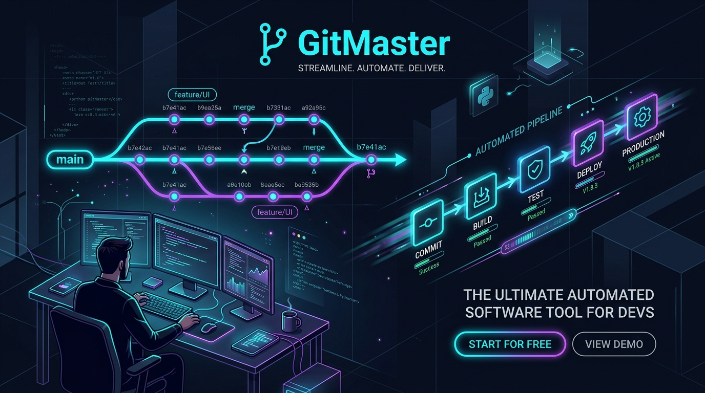

<p align="center">
  
</p>

# 🚀 GitMaster

> Herramienta automatizada para monitorizar múltiples repositorios Git locales, descargar novedades (`git pull`), compilar (`build`) si es necesario y reiniciar automáticamente los procesos en **PM2** solo si están encendidos.

Construido con **Node.js**, **TypeScript** y gestionado estrictamente con **`pnpm`**.

---

## 📋 Características Principales

- 🔄 **Vigilancia Multi-Proyecto**: Controla tantos proyectos y carpetas locales como necesites simultáneamente.
- ⏱ **Intervalos Flexibles**: Define un intervalo global (ej. cada 60s) o intervalos independientes por proyecto.
- 🔍 **Detección No Invasiva**: Comprueba `git fetch` y compara el commit local `HEAD` contra la rama remota antes de tocar tu código de trabajo.
- 📦 **Instalación de Dependencias Inteligente**: Si detecta cambios en `pnpm-lock.yaml` o `package.json`, ejecuta `pnpm install` automáticamente.
- ⚙️ **Compilación a Medida**: Ejecuta el comando de build configurado (ej: `pnpm run build`, `npm run build`, etc.) tras cada actualización.
- ⚡ **Control PM2 Inteligente**: Comprueba si el proceso está activo (`online`) en PM2. Si está encendido, ejecuta `pm2 restart <proceso>`. Si no está encendido o no existe, lo notifica sin interrumpir nada.
- 🛡️ **Seguridad contra Sobreescrituras**: Protege repositorios con cambios locales no commiteados (opción `autoStash` configurable).
- 📜 **Logs en Tiempo Real y Archivo**: Salida detallada con colores en consola y guardado permanente en `logs/gitmaster.log`.

---

## 🛠️ Instalación y Compilación

El proyecto usa exclusivamente **`pnpm`**:

```bash
# Instalar dependencias
pnpm install

# Compilar TypeScript a producción (en /dist)
pnpm run build
```

---

## ⚙️ Configuración (`config.jsonc` / `config.json`)

El archivo [`config.jsonc`](./config.jsonc) (o `config.json`) está completamente en español y admite comentarios explicativos:

```json
{
  // Intervalo general en segundos entre revisiones si un proyecto no tiene el suyo
  "intervaloPorDefectoSegundos": 60,

  // Proyectos que pueden revisarse simultáneamente
  "concurrencia": 2,

  // Lista de tus proyectos a vigilar (tantos como quieras)
  "proyectos": [
    {
      // Nombre identificador para los registros y avisos
      "nombre": "mi-backend",

      // Ruta exacta a la carpeta del proyecto en tu disco
      "ruta": "C:/mis-proyectos/mi-backend",

      // Rama de Git que quieres vigilar (ej. "main" o "master")
      "rama": "main",

      // Frecuencia en segundos para vigilar este proyecto en particular
      "intervaloSegundos": 30,

      // Si es true, ejecuta 'pnpm install' automáticamente cuando cambien librerías
      "instalarDependencias": true,

      // Comando para instalar dependencias
      "comandoInstalar": "pnpm install",

      // Comando para compilar tu proyecto tras el git pull
      "comandoBuild": "pnpm run build",

      // Configuración de PM2 (puedes poner null si este proyecto no usa PM2)
      "pm2": {
        // Nombre o ID del proceso en PM2
        "nombreProceso": "backend-api",

        // Acción: "restart" (reinicio) o "reload" (recarga)
        "accion": "restart",

        // false = SOLO reinicia si ya está encendido en PM2. true = lo arranca aunque esté apagado
        "iniciarSiEstaApagado": false
      },

      // Guardar cambios locales sin commitear en stash temporal antes del pull
      "guardarCambiosLocalesAuto": false,

      // true = vigilar este proyecto. false = ignorar temporalmente
      "activado": true
    }
  ]
}
```

---

## 🖥️ Uso de la Línea de Comandos (CLI)

### 1. Iniciar la vigilancia continua
```bash
# Modo desarrollo
pnpm run dev

# Modo producción compilado
pnpm start
```

### 2. Forzar comprobación inmediata (Check Once)
```bash
# Comprobar todos los proyectos inmediatamente y salir
pnpm cli check-now

# Comprobar únicamente un proyecto específico
pnpm cli check-now mi-api-backend
```

### 3. Listar proyectos configurados
```bash
pnpm cli list
```

### 4. Añadir un proyecto desde la terminal
```bash
pnpm cli add -n "mi-bot" -p "C:/proyectos/mi-bot" --branch "main" --interval 45 --build "pnpm build" --pm2 "bot-process"
```

### 5. Eliminar un proyecto
```bash
pnpm cli remove "mi-bot"
```

### 6. Ver el estado de procesos en PM2
```bash
pnpm cli pm2-status
```

---

## 🔄 Ejecutar GitMaster como Servicio en PM2

Para dejar GitMaster corriendo 24/7 en segundo plano en tu equipo:

```bash
# 1. Compilar
pnpm run build

# 2. Iniciar GitMaster en PM2
pm2 start dist/index.js --name "gitmaster"

# 3. Guardar el estado de PM2 para que inicie con el sistema
pm2 save
```
